# folderview

Browse, search and review any folder in your browser, on your computer or your phone.

```sh
npx folderview                       # the current folder, on http://localhost:4190
npx folderview ~/my-app --lan --open # another folder, reachable from your phone too
```

Or install it once with `npm i -g folderview`, then run `folderview`.

You get:

- **Code**, highlighted by Shiki, with line numbers and git change bars.
- **Markdown**, rendered the way GitHub renders it, plus **Mermaid diagrams** and **math**.
- **Previews** for images, audio, video, PDF, CSV, JSON, notebooks and fonts.
- **Git:** status colours, diffs and history.
- **Search** across files, and a fuzzy **Go to file**.
- **Downloads**, for single files and for whole folders as a zip.
- A **review mode**. Your comments on lines are saved to a file that an LLM agent can read and work through. Its
  replies show up in your browser as it works.

The screenshots show folderview at phone size, open on a small demo repository (`npm run screenshots` builds it).

| | | |
|:-:|:-:|:-:|
| 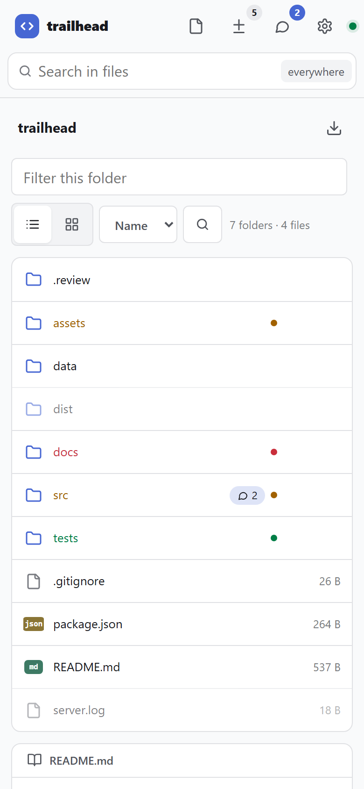 | 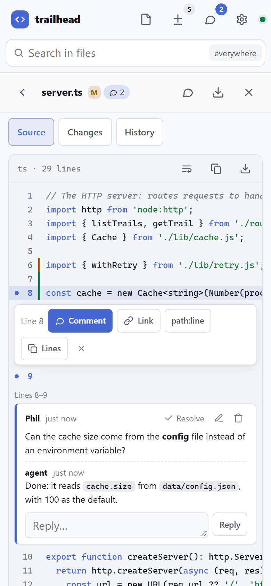 | 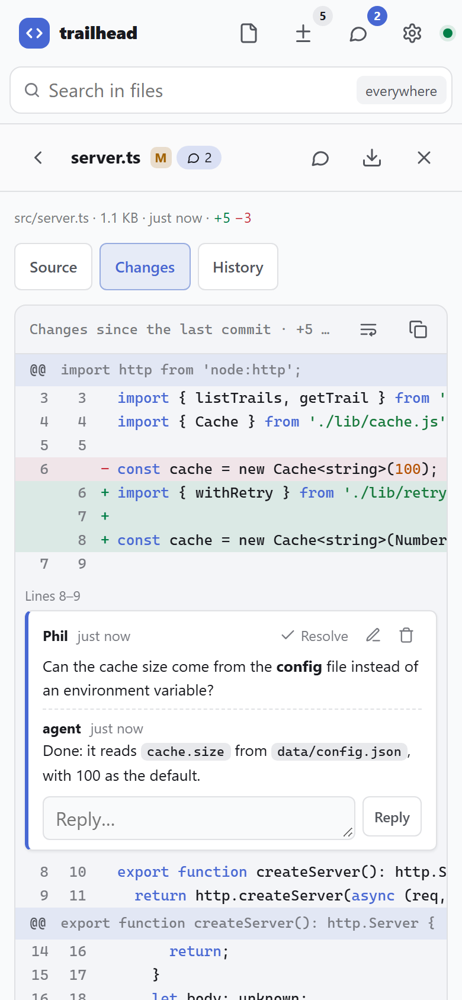 |
| **Folders** with git colours | **Code**, with change bars | **Changes** for one file |
| 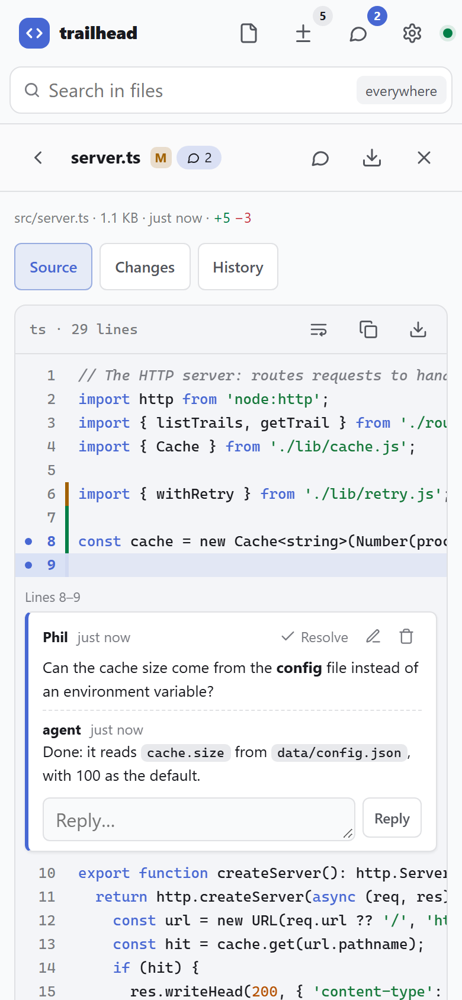 | 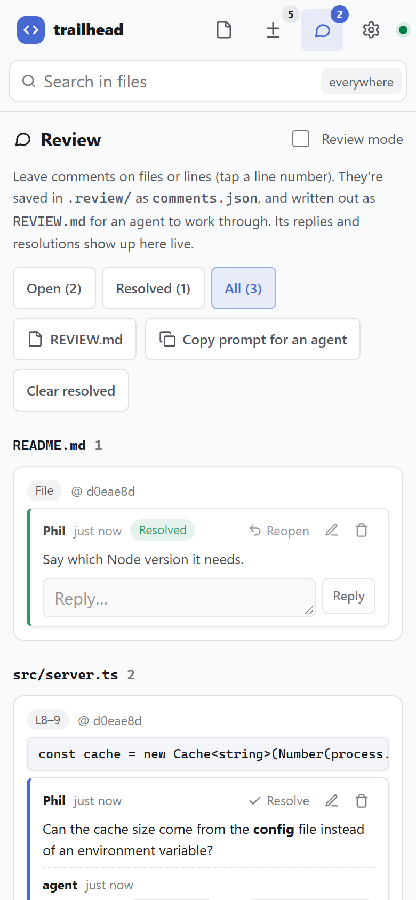 | 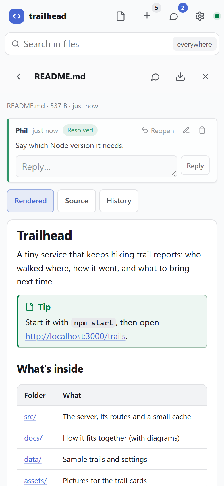 |
| **Review** comments on lines | Every comment, for an **agent** | **Markdown** |
| 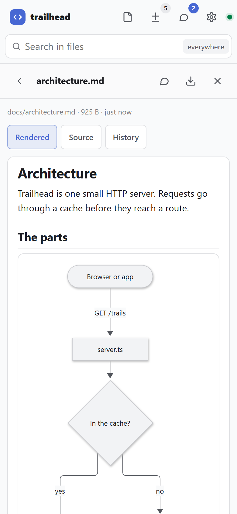 | 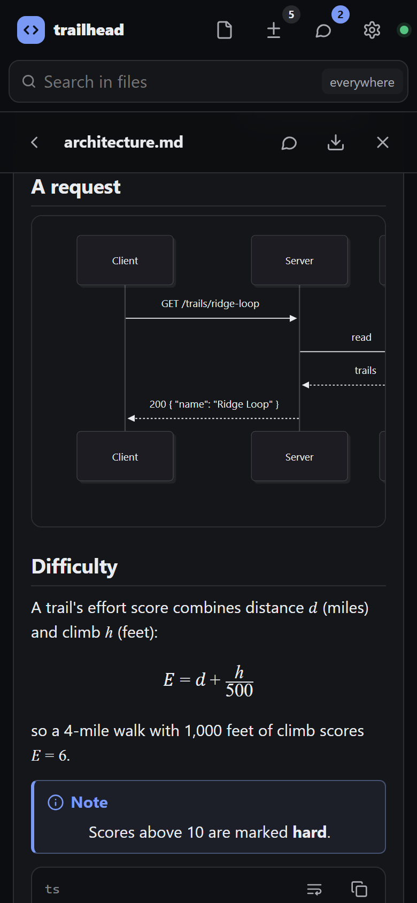 | 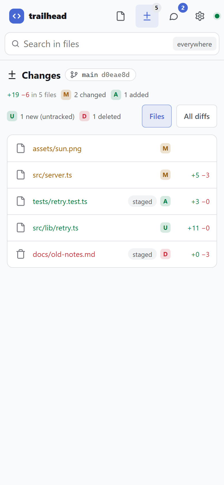 |
| **Mermaid** diagrams | **Math** and code, dark mode | **All changes** |
| 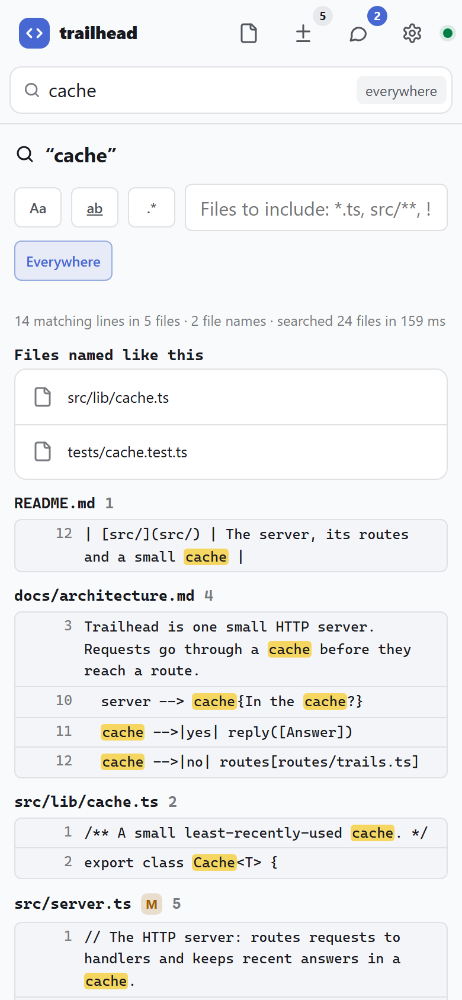 | 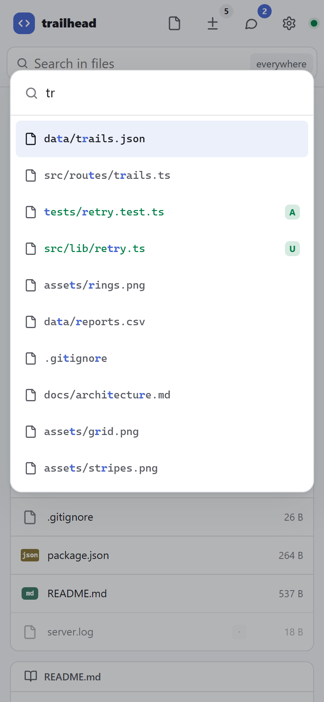 | 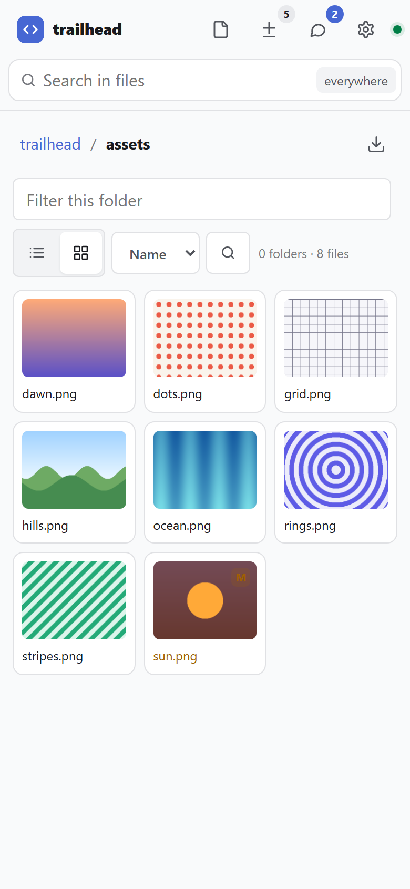 |
| **Search** in files | **Go to file** | **Thumbnails** |
| 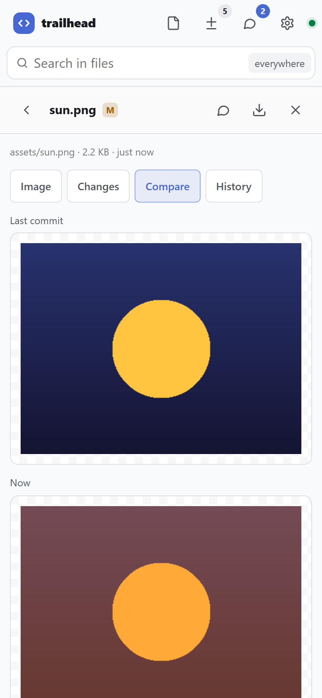 | 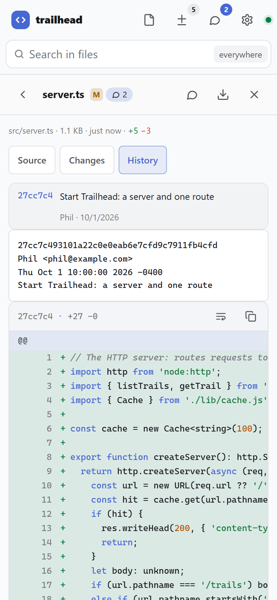 | 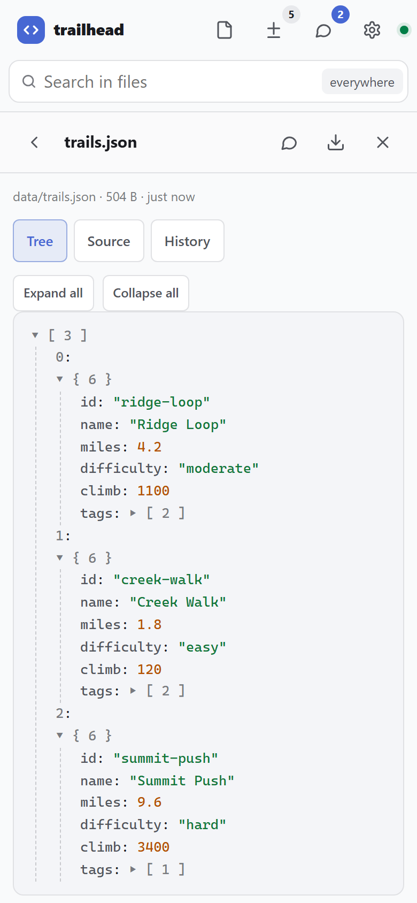 |
| **Images**: before and after | **History** | **JSON** tree |
| 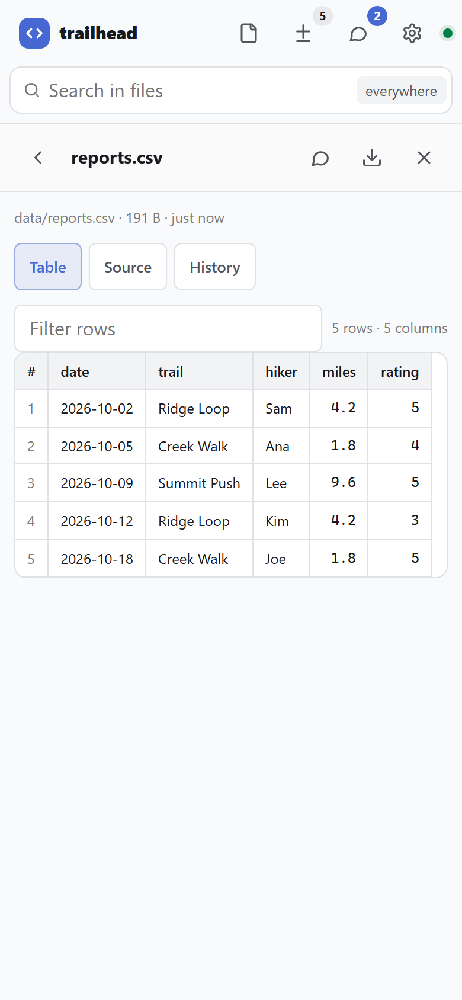 | 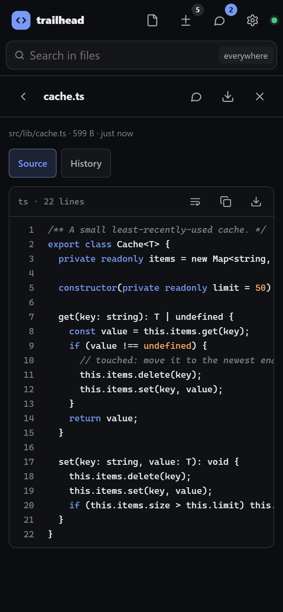 | 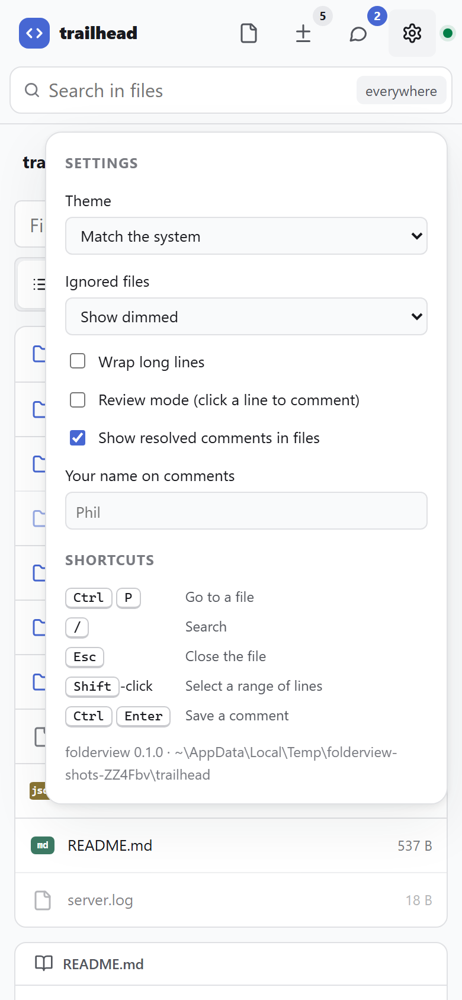 |
| **CSV** as a table | **Dark mode** | **Settings** |

[docs/examples/markdown.md](docs/examples/markdown.md) shows everything the markdown view can draw.

## Viewing files

Each kind of file gets its own view. Files with source text also get a **Source** tab:

| Files | Shown as |
|---|---|
| Code and text (200+ languages) | Highlighted, with line numbers, change bars from git, wrap, copy, download, and links to a line (`#…&line=12` or `12-20`). |
| Markdown | Rendered GitHub-style: tables, task lists, `> [!NOTE]` alerts, footnotes, heading anchors, front matter, sanitised inline HTML, Mermaid (` ```mermaid `), math (`$…$`, `$$…$$`, ` ```math `). Relative links open in the viewer, and relative images load from the folder. |
| `.mmd`, `.mermaid` | The diagram |
| Images, SVG | The image and its size. Tap for full size. **Mark an area** lets you draw on it to comment on that spot. |
| Audio, video | A player that can seek |
| PDF | The browser's PDF viewer |
| HTML | A sandboxed preview where scripts don't run |
| CSV, TSV | A table you can sort and filter |
| JSON | A collapsible tree |
| Jupyter notebooks | Cells, outputs and plots |
| Fonts | Samples at several sizes, in your own text |
| Anything else | A hex dump of the first bytes |

The arrows in a file's header open the previous or next file in its folder (by name). Press <kbd>[</kbd> or
<kbd>]</kbd>, use <kbd>←</kbd> <kbd>→</kbd> on a picture, or swipe a picture sideways on a phone.

Every file has a **Download** button. Every folder has one too, which downloads the folder as a `.zip` of what the
listing shows.

## Git

When the folder is in a git repository:

- **Colours:** names are coloured by state. Green is new or added, orange is changed, red is deleted, blue is
  renamed, purple is a conflict. Ignored files are dimmed, or hidden if you choose.
- **Folders:** each folder has a dot for the most important change inside it.
- **Deleted files** still show, struck through, so you can open what they were.
- **Branch:** the top bar shows the branch, its commit, and how far it is ahead of or behind its upstream.
- **Changes:** lists every changed file with lines added and removed, and whether it's staged. It can also show
  the diffs themselves, 50 files a page (**View all** puts every one on a single page), where each file collapses on its own (or all at once) and takes comments on the whole
  file or on a line. Long lines scroll sideways inside each diff, or wrap (the wrap button, or Settings → Wrap long
  lines, which applies everywhere).
- **History:** the Changes page's **History** tab lists the commits, newest first. Each is marked **Pushed** (on a
  remote) or **Not pushed** (only in this copy), and commits on the upstream you haven't pulled yet are listed above
  them. Tap a commit to see its message and every file it changed, with the same collapsible diffs (images show
  before and after). Long histories load a page at a time as you scroll, and the search box finds a commit by words
  in its message or by its hash.
- **Long names** show in full: a path wraps at its folders, and a file's name in its header scrolls sideways.
- **Each file** has **Changes** (its diff against the last commit) and **History** (its commits; tap one to see what
  it changed). Images also get **Compare**: before and after, side by side.

## Search

- **Search in files:** press <kbd>/</kbd> or tap the search bar.
  - Search everywhere, or only in the open folder.
  - Turn on match case, whole word, or regular expression.
  - Narrow it to some files with patterns like `*.ts, src/**, !*.test.ts`.
  - In a git repository it uses `git grep` to find candidate files first, so it's quick on big repositories.
  - It skips ignored files, excluded files, secrets and binaries.
- **Go to file:** press <kbd>Ctrl</kbd> <kbd>P</kbd> (or <kbd>Ctrl</kbd> <kbd>K</kbd>), or tap the file icon. Type
  any part of a file or folder name. Start with `?` to search inside files instead.

## Live

When a file changes on disk, open pages update by themselves: the listing, the git colours, and the open file.

## Review mode: comments an agent can work through

1. **Comment.** Tap a line number (Shift-click for a range), then **Comment**. The comment button in a file's header
   comments on the whole file. You can comment on diff lines too. On a picture, **Mark an area** and draw around
   what you mean: the comment keeps the marks, the area they cover in the image's pixels, and a copy of the picture
   with the marks drawn on it (`.review/images/<id>.png`, linked from `REVIEW.md` so an agent can look at it). Turn on **Review mode** in Settings and a single
   tap on any line starts a comment.
2. **Saved.** Comments are saved to `.review/comments.json`. Each one keeps the quoted lines and the commit it was
   left on. The same comments are written to `.review/REVIEW.md`, grouped by file, with instructions for an agent.
3. **Hand it to your agent.** The Review page has **Copy prompt for an agent**. Paste it into Claude Code (or any
   coding agent). The agent reads `REVIEW.md`, makes the changes, then sets each comment to `"resolved"` in
   `comments.json` and adds a reply.
4. **Watch it work.** folderview watches `comments.json`, so the agent's replies and resolutions appear in your
   browser as they happen.

### Where to look for feedback

folderview points you, or your agent, at the feedback in three places:

- **When it starts:** the terminal shows where comments are saved, plus an instruction you can paste into an agent:

  ```
  Review feedback is saved to .review/REVIEW.md (and .review/comments.json).
  For an agent: "Read .review/REVIEW.md. It lists review comments on files in this folder ..."
  There are 2 open comments waiting: npx folderview review
  ```

- **While it runs:** each time the comments change, it prints a line. An agent that started folderview in the
  background sees these in its output:

  ```
  [9:16:04 PM] review: 2 open comments (of 2) → .review/REVIEW.md  (or run: npx folderview review)
  [9:16:24 PM] review: no open comments (2 resolved)
  ```

- **Any time:** `folderview review` prints the open comments in the folder (the same text as `REVIEW.md`), even when
  folderview isn't running. Add `--all` to include resolved ones, or `--json` for a script.

  ```sh
  npx folderview review            # what's open, with instructions for an agent
  npx folderview review ../app --all --json
  ```

To make an agent check on its own, add a line to its instructions file (`CLAUDE.md`, `AGENTS.md`, …):

```md
Before finishing a task, run `npx folderview review` and work through any open review comments.
```

Comments have replies, editing, resolve and reopen, and delete. Agents and scripts can also use the
[API](#the-api) directly.

## Options

```
folderview [folder] [options]
```

| Option | Environment variable | Default | |
|---|---|---|---|
| `folder` | `FOLDERVIEW_ROOT` | the current folder | The folder to serve |
| `-p, --port <n>` | `FOLDERVIEW_PORT` | `4190` | The port to try first; the next free one is used |
| `-H, --host <addr>` | `FOLDERVIEW_HOST` | `127.0.0.1` | The address to listen on |
| `--lan` | | | Same as `--host 0.0.0.0`: reachable from your phone and other devices |
| `--base <path>` | `FOLDERVIEW_BASE` | `/` | Serve under a URL path, such as `code` or `team/code`, behind a reverse proxy. See [Under a path](#under-a-path). |
| `-o, --open` | `FOLDERVIEW_OPEN` | off | Open it in your browser |
| `-x, --exclude <globs>` | `FOLDERVIEW_EXCLUDE` | | Never show, serve, search or zip these. Comma-separated and repeatable. See [Excluding files](#excluding-files). |
| `--hide <names>` | `FOLDERVIEW_HIDE` | | Exact names to hide everywhere (`.git` always is) |
| `--show-secrets` | `FOLDERVIEW_SHOW_SECRETS` | off | Show `.env*`, `*.key`, `*.pem` and `id_rsa`-style files |
| `--token <t>` | `FOLDERVIEW_TOKEN` | | Require a token. Open `?token=…` once and it's kept as a cookie. |
| `--allow-host <h>` | `FOLDERVIEW_ALLOW_HOSTS` | | Also accept this host name, such as a tunnel's (`*` for any) |
| `--review-dir <dir>` | `FOLDERVIEW_REVIEW_DIR` | `.review` | Where comments are saved |
| `--title <name>` | `FOLDERVIEW_TITLE` | the folder's name | The name at the top of the page |
| `--author <name>` | `FOLDERVIEW_AUTHOR` | git `user.name` | The default name on comments |
| `--max-file-mb <n>` | `FOLDERVIEW_MAX_FILE_MB` | `5` | Larger files aren't shown as text or searched (download still works) |
| `--read-only` | `FOLDERVIEW_READ_ONLY` | off | Nobody can add comments |
| `--no-git` | `FOLDERVIEW_GIT=false` | git on | Don't use git |
| `--no-watch` | `FOLDERVIEW_WATCH=false` | watch on | No live updates |
| `--print-config` | | | Print the settings and where each came from, then exit |

`folderview --help` prints every option and command. Agents should run it before guessing at flags.

### Under a path

`--base team/code` serves everything under `/team/code/`: the page, its scripts, files, search, live updates and the
API. Any depth works, and `team/code`, `/team/code`, `/team/code/` and a full `https://host/team/code` mean the same.
The token cookie is kept to that path, `/team/code` redirects to `/team/code/`, and nothing is served outside it. Point
your proxy at folderview without stripping the path.

In Git Bash on Windows, leave off the leading slash: Git Bash rewrites `/team/code` into `C:/Program Files/Git/team/code`
before folderview sees it (folderview refuses that, and says why). `MSYS_NO_PATHCONV=1` turns the rewriting off.

Settings come from these places, highest first:

1. **Flags** on the command line.
2. **Environment variables.**
3. **`.folderviewrc.json`** in the folder.
4. **Your config file**, `~/.config/folderview/config.json`. `$XDG_CONFIG_HOME` moves it, or set `FOLDERVIEW_CONFIG` to
   any path.
5. **The defaults.**

For true/false variables, `0`, `false`, `no` and `off` all mean off.

Both config files use the option names in camelCase:

```json
{
  "port": 4300,
  "exclude": ["*.log", "coverage/", "**/*.min.js"],
  "title": "My app",
  "readOnly": false
}
```

## Excluding files

Exclude patterns add up from every source: your config file, `.folderviewrc.json`, `FOLDERVIEW_EXCLUDE`, `--exclude`,
and a **`.folderviewignore`** file in the folder (one pattern per line, `#` for comments). They use `.gitignore`
syntax:

| Pattern | Excludes |
|---|---|
| `*.log` | Any `.log` file, in any folder |
| `dist/` | Any folder named `dist`, and everything in it |
| `/secrets` | Only `secrets` at the top of the folder |
| `docs/**/*.tmp` | `.tmp` files anywhere under `docs` |
| `!keep.log` | An exception to an earlier pattern |

An excluded file can't be listed, opened, downloaded, searched or zipped, even by URL.

These are hidden even without any patterns:

- `.git`.
- **Secrets:** `.env*` (except `.env.example` and `.env.sample`), `*.key`, `*.pem`, `*.p12`, `*.pfx` and `id_rsa`-style
  keys. `--show-secrets` shows these.

Git-ignored files (like `node_modules`) are shown dimmed, and search skips them.

## Safety

- **Local by default.** It listens on `127.0.0.1` unless you pass `--lan` or `--host`. Anyone who can reach the port
  can read every file that isn't hidden or excluded. On a shared network, add `--token` (or `FOLDERVIEW_TOKEN`).
- **Nothing outside the folder** is served, even through symlinks.
- **DNS rebinding:** requests for unknown host names are refused. Use `--allow-host` for a tunnel or proxy name.
- **Writes** (comments) must come from the page itself. Posts from other sites are refused.
- **No scripts from your files:**
  - Files are served with a strict Content-Security-Policy, so an SVG or HTML file can't run script.
  - HTML previews are sandboxed.
  - Markdown is sanitised.
  - Mermaid runs in strict mode and is drawn as an image.
- **Writes nothing else.** The only files folderview writes are in the review folder.

## The API

Everything the page does goes through a small JSON API (under `--base`, if set):

| Request | Gives |
|---|---|
| `GET api/info` | The folder's name, git, the review files, settings the page needs |
| `GET api/list?p=<folder>` | A folder's entries |
| `GET raw/<path>` | A file (supports `Range`). Add `?download=1` to download it. |
| `GET api/zip?p=<folder>` | A folder as a `.zip` |
| `GET api/files` | Every file (git-aware) |
| `GET api/search?q=&scope=&regex=1&case=1&word=1&include=` | Matches by file and line |
| `GET api/git/status` | Branch, ahead/behind, each change with +/− |
| `GET api/git/diff?p=` | A file's diff against the last commit |
| `GET api/git/log?p=` | A file's history |
| `GET api/git/show?p=&rev=` | A file at a commit |
| `GET api/comments` | Every comment |
| `POST api/comments` | Add one: `{ path, line?, endLine?, body, author? }` |
| `PATCH api/comments/<id>` | `{ status: "resolved" }` or `{ body }` |
| `POST api/comments/<id>/replies` | `{ body, author }` |
| `DELETE api/comments/<id>` | Delete one |
| `GET api/review.md` | The agent-ready summary |
| `GET api/events` | Server-sent events: `change` (files, git) and `comments` |

With a token set, send `Authorization: Bearer <token>`.

## Develop

```sh
npm install
npm run dev -- ../some-folder     # build everything and serve a folder
npm run watch:client              # rebuild the page as you edit client/ (run the server separately)
npm test                          # build, then run the tests
npm run screenshots               # retake docs/screenshots at phone size, on a fresh demo repository
                                  # (needs: npx playwright install chromium)
```

- **The server** is TypeScript in `src/`. It needs Node 20 or newer and has no runtime dependencies.
- **The page** is plain JavaScript in `client/`. esbuild bundles it into `dist/client` and splits out what loads
  only when needed: Shiki's grammars, Mermaid and the math renderer.
- **The look** is one set of design tokens: one indigo accent, calm neutrals, and light and dark modes.
