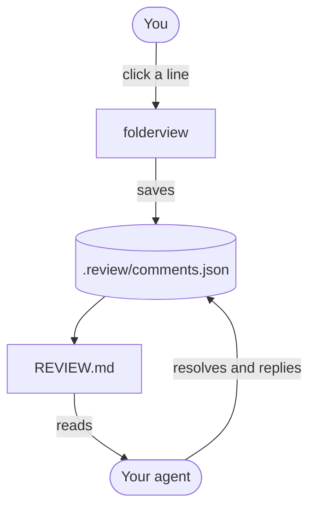
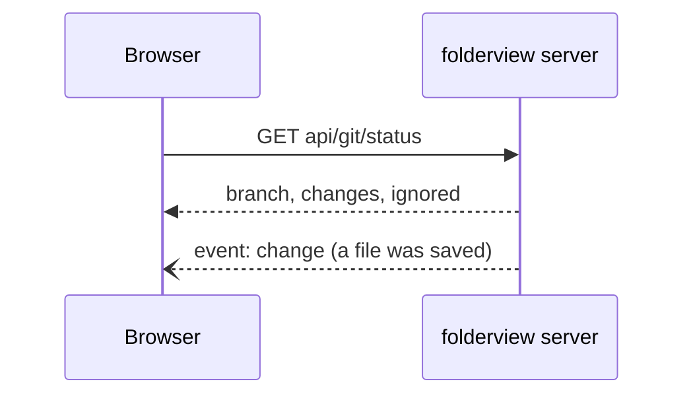

# What folderview renders

Markdown is drawn the way GitHub draws it, plus diagrams and math. Open this file in folderview to see it.

> [!NOTE]
> Relative links like [the README](../../README.md) open in the viewer, and `path#L12` links jump to a line.

## A diagram





## Math

The area of a circle is $A = \pi r^2$, and a sum like

$$
\sum_{k=1}^{n} k = \frac{n(n+1)}{2}
$$

is drawn as real math.

## Code

```ts
// highlighted by Shiki, in the harness code look
export async function review(path: string, line: number): Promise<Comment> {
  const res = await fetch('api/comments', { method: 'POST', body: JSON.stringify({ path, line }) });
  return res.json(); // 201 Created
}
```

## Tables, tasks and the rest

| Feature | Where |
|---|:-:|
| Git colours | everywhere |
| Search | `/` |
| Quick open | `Ctrl` + `P` |

- [x] Highlighting with Shiki
- [x] Mermaid diagrams
- [ ] Your idea here

> [!TIP]
> Turn on **Review mode** in settings and one click on any line starts a comment.

<details>
<summary>Inline HTML works too (sanitised)</summary>

Scripts and event handlers are removed; <kbd>Ctrl</kbd> + <kbd>K</kbd> still shows as keys.

</details>

Footnotes work as well.[^1]

[^1]: Like this one.
